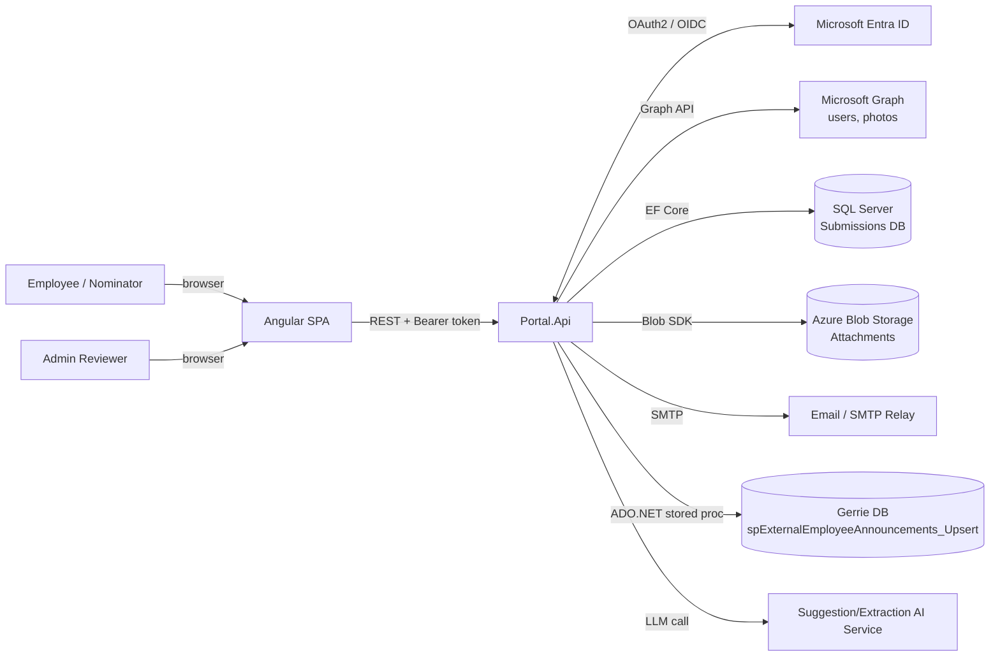
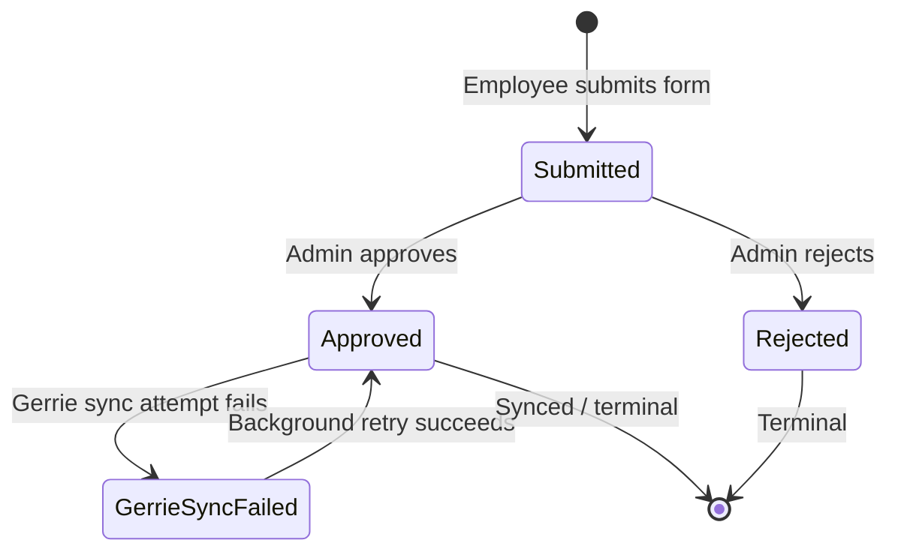
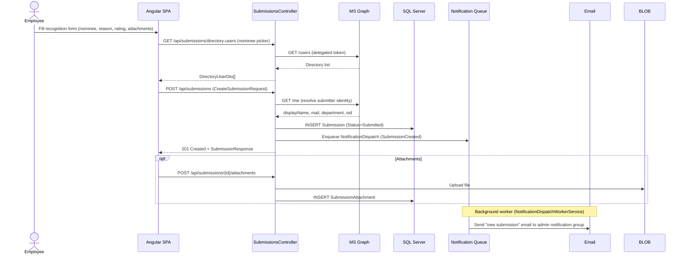
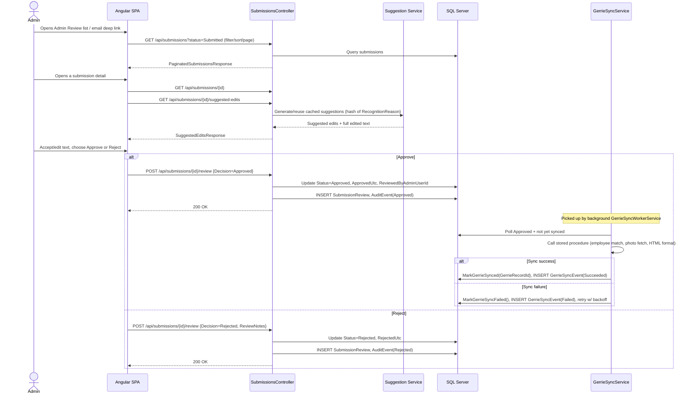
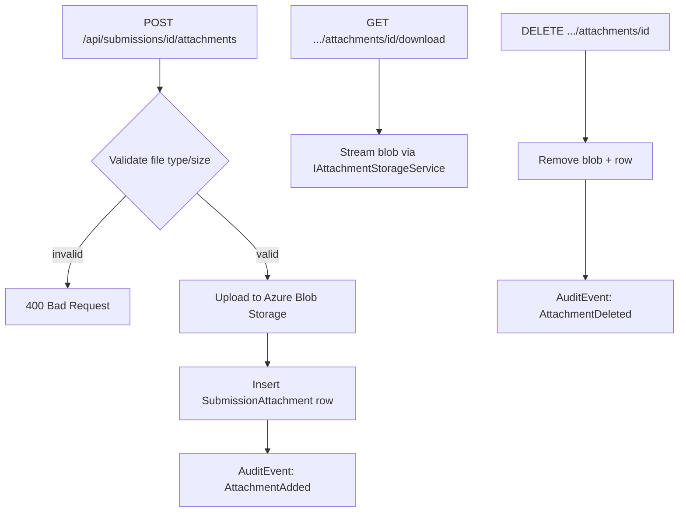
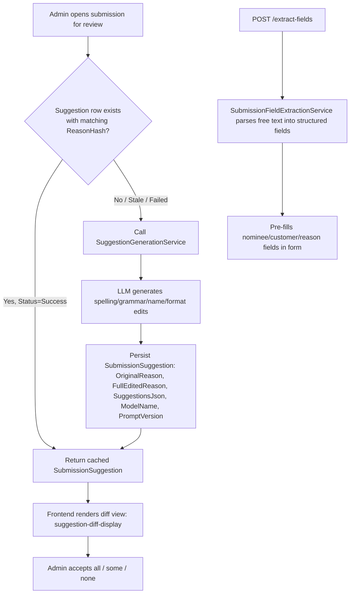
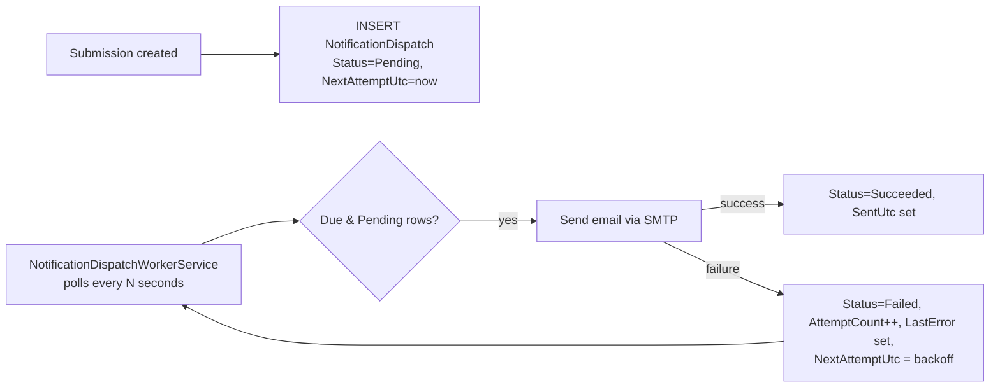
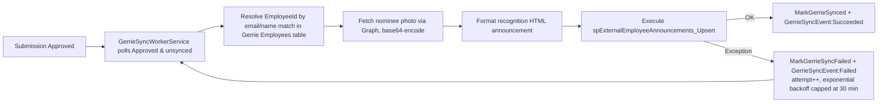
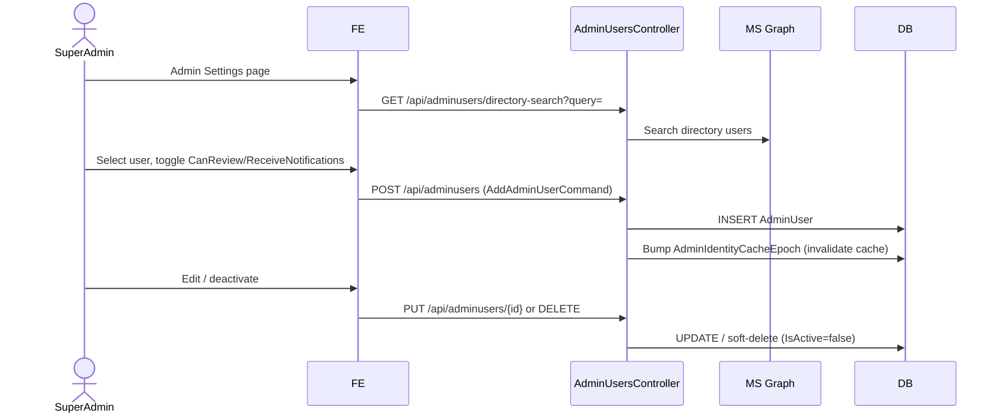
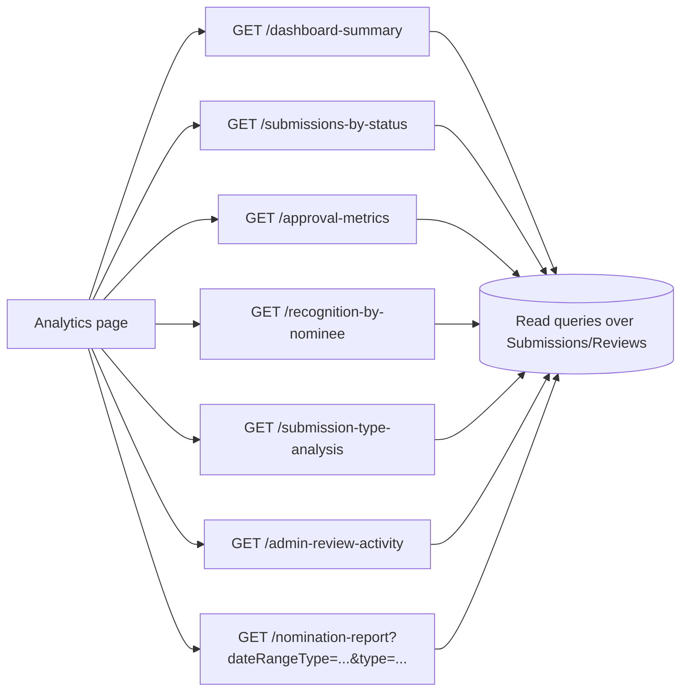

# Customer First Portal — Process Flow Documentation

Employee recognition platform: Angular 19 SPA + ASP.NET Core 10 API (Clean Architecture) + SQL Server, with Entra ID auth, Azure Blob attachments, AI-assisted text suggestions, email notifications, and one-way sync to the "Gerrie" announcements system.

## 1. System Context

## 2. Core Domain Lifecycle (Submission State Machine)

Notes:
- `Draft` and `GerrieSynced` exist in the enum but current code keeps synced records at `Approved` (`MarkGerrieSynced` intentionally does not set `GerrieSynced`, to avoid surfacing a legacy status in the UI).
- Only `Submitted` submissions `CanBeReviewed()`. Already-decided submissions cannot be re-reviewed (idempotent review endpoint).

## 3. Submission Creation Flow (Employee → Employee / Employee on behalf of Customer)

## 4. Admin Review & Decision Flow

### Review guardrails
- `[Authorize(Policy = "AdminOnly")]` — enforced by `AdminOnlyHandler`, which checks the `Admin` role claim OR an active `AdminUser` row (by Entra Object ID, then email), cached per-request via `IAdminIdentityResolver` + `IMemoryCache` with a cache epoch for instant invalidation on admin-list changes.
- Submission can only be reviewed while `Status == Submitted` (re-review attempts are rejected/no-op).
- `UpdateSubmission` (`PATCH /api/submissions/{id}`) lets an admin edit fields pre-decision; uses optimistic concurrency (`RowVersion`).

## 5. Attachment Handling

## 6. AI-Assisted Suggestion & Field Extraction Flow

Suggestions are generated once per distinct `RecognitionReason` (via content hash) and reused on every subsequent view to control AI cost; `POST /{id}/regenerate-suggestions` forces a fresh pass.

## 7. Notification Dispatch Flow (background worker)

## 8. Gerrie Sync Flow (background worker, one-way outbound)

## 9. Admin User Management (RBAC) Flow

## 10. Analytics Flow

All analytics endpoints are `AdminOnly` and read-only (CQRS queries, no handlers mutate state).

## 11. Frontend Route Map

| Route | Component | Guard |
|---|---|---|
| `/submissions` | SubmissionsListComponent | authGuard |
| `/submissions/employee` | EmployeeRecognitionComponent (submit form) | authGuard |
| `/submissions/customer` | CustomerRecognitionComponent (submit form) | authGuard |
| `/admin-review` | AdminReviewComponent (queue) | adminGuard |
| `/admin-review/:submissionId` | AdminReviewDetailComponent | adminGuard |
| `/admin-settings` | AdminSettingsComponent (RBAC) | adminGuard |
| `/analytics` | AnalyticsComponent | adminGuard |

`adminMatchGuard` hides admin routes from the router config entirely for non-admins (lazy route protection in addition to `canActivate`).

## 12. End-to-End Happy Path (Summary)

1. Employee signs in via Entra ID → SPA obtains token.
2. Employee submits recognition (`POST /api/submissions`) → `Submitted`, notification queued.
3. Background worker emails the admin notification group with a secure review link.
4. Admin opens review queue/detail, optionally applies AI suggestions, approves or rejects.
5. Approve → audit logged → background worker syncs to Gerrie (retried with backoff on failure).
6. Reject → audit logged → terminal, no sync.
7. Admin analytics dashboard reports on volumes/approvals/top nominees at any time.

## 13. Key Cross-Cutting Mechanisms

- **CQRS**: MediatR commands/queries per feature (`Features/<Area>/<Action>`), validated with FluentValidation (`FluentValidationBehavior`).
- **Correlation**: `CorrelationIdMiddleware` tags every request/log for traceability across the async workers.
- **Optimistic concurrency**: `RowVersion` on `Submission` and `SubmissionSuggestion` guards concurrent admin edits.
- **Caching**: Admin identity cache (memory cache + epoch invalidation) and Graph profile-photo distributed cache (`DistributedPhotoCache`, 7-day response cache on the photo endpoint).
